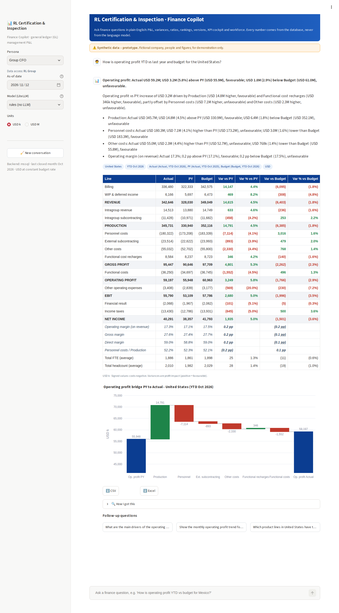

# RL Finance Copilot

A conversational finance-analytics prototype for a fictional TIC company, **RL Certification &
Inspection** (Americas). Business leaders ask finance questions in plain English. Every answer
returns a short insight, a finance-style table, a chart, the filters / version / period used, and
three follow-up questions. The data is a synthetic AD50 management P&L in SQL Server 2022.

On 71 golden questions with SQL ground truth, **gpt-oss:20b on CPU passed every check** (status, tool chosen by the LLM itself, expected numbers, headline number in the answer) at a **14.5 s median**, faster than the default qwen2.5-coder:14b (24.1 s, which needed the router fallback on 3 tool choices). The deterministic rules router also passes every check, in 0.12 s, but writes templated text instead of a narrative.



## What it runs on

| Component | Details |
|---|---|
| Data | Synthetic AD50 monthly P&L, lines 01–21, plus FTE and headcount. 109 business units in 11 countries, 5 regions and 8 product lines. Actual covers Jan 2022–Oct 2026; Budget and FC1–FC3 cover 2022–2026. 1,201,834 P&L fact rows and 32,482 statistics rows, in USD at budget rate B26 |
| Database | SQL Server 2022 Developer (16.0) with native row-level security (security policy + `SESSION_CONTEXT`) and a least-privilege reader login. A DuckDB file holds the same data as a light alternative |
| Agent | LangGraph 1.2 state graph with 8 typed tools on a semantic layer (SQLAlchemy 2.1 Core and a metric registry) and a numeric guardrail. LLM calls go through LiteLLM 1.109, so any provider string works |
| Default LLM | `qwen2.5-coder:14b`: 14.8B-parameter dense decoder-only transformer, 4-bit GGUF (Q4_K_M), served by Ollama 0.40.16 on CPU |
| Other LLMs evaluated | `llama3.1:8b` (8.0B dense, Q4_K_M); `gpt-oss:20b` (20.9B mixture-of-experts, MXFP4) |
| UI | Streamlit 1.67 and Plotly 7.1 |
| Hardware | Kubernetes CPU node pool with 2× c3-standard-44 (44 vCPU Intel Xeon Platinum 8481C and 176 GB RAM each). The Ollama pod is limited to 40 vCPU / 48 GiB. No GPU or TPU |

## Main results

**Golden-question evaluation.** 71 questions; backend SQL Server; as-of date 2026-11-12.
Expected values come from raw SQL on the base tables (`tests/eval_dsl.py`), not from the semantic
layer.

| Model (all on CPU) | Status as expected | Tool chosen by the LLM alone | Expected numbers in tool output | Headline number in answer text | Guardrail passed first time | Latency p50 / p95 |
|---|---:|---:|---:|---:|---:|---:|
| **gpt-oss:20b** | 71/71 | **67/67** | 67/67 | 67/67 | **96%** | 14.5 s / 27.6 s |
| llama3.1:8b | 71/71 | 65/67 | 67/67 | 67/67 | 79% | **12.1 s / 20.5 s** |
| qwen2.5-coder:14b (default) | 71/71 | 64/67 | 67/67 | 67/67 | 79% | 24.1 s / 37.0 s |
| rules (no LLM, templated text) | 71/71 | n/a | 67/67 | 67/67 | n/a | 0.12 s / 0.37 s |

When the LLM's tool call is unusable, a deterministic router supplies one. With that fallback, the final tool choice was right on 67/67 for every model except llama3.1:8b (66/67). The golden set was written alongside the router, and the LLM-side fixes were found on these same questions, so these are not held-out scores. Before those fixes, qwen2.5-coder:14b stated the headline number in 65/67 answers (see [APPENDIX.md](APPENDIX.md)).

**Data pipeline.**

| Check | Result |
|---|---|
| Load into SQL Server (schema, facts, views, RLS) | 1,201,834 P&L rows + 32,482 statistics rows in 18.3 s |
| DuckDB copy vs SQL Server | identical row counts and totals per version |
| Leaf accounts vs AD50 subtotals | 0 mismatches in 300 checks ([report](results/reconcile_report_mssql.md)) |

## How to reproduce

The results above were produced on Kubernetes. Only `kubectl` runs on the workstation.

```bash
cp .deploy.env.example .deploy.env     # project, cluster, namespace, node pool, kubeconfig path
make k8s-deploy                        # namespace, SQL secret, SQL Server 2022, Ollama, dev pod
make k8s-models                        # qwen2.5-coder:14b, llama3.1:8b, gpt-oss:20b (about 27 GB)
make k8s-sync k8s-env                  # copy the code and the pod .env
make k8s-make T="setup db-up data load reconcile test"
make k8s-ready                         # start Streamlit in the app container
make k8s-forward                       # UI on http://localhost:8501 (authenticated port-forward)
make k8s-make T="eval MODELS=rules,ollama/qwen2.5-coder:14b,ollama/llama3.1:8b,ollama/gpt-oss:20b"
make k8s-make T="demo MODEL=ollama/qwen2.5-coder:14b"
make k8s-pull                          # copy results/ and eval_report.md back
```

On a single host with Docker, the same stack runs with `cp .env.example .env` (set the two SQL
Server passwords), then `make setup db-up data load reconcile test run`. For the optional local
LLM, see the header of `docker-compose.yml`. This path was not run for these results, because
Docker is blocked on the build laptop. The `Dockerfile` was built in the cluster with kaniko
instead (see `results/build/`). Without SQL Server, `DB_BACKEND=duckdb` runs everything on the
DuckDB file.

## More detail

- [APPENDIX.md](APPENDIX.md): constraints, progression, what failed and the fix, evaluation method, caveats.
- [eval_report.md](eval_report.md): results per model and per category, and every failed check.
- [`results/`](results/): raw evaluation records, saved demo answers per model, UI screenshots,
  the reconciliation report and the Docker build log.
- [`docs/`](docs/): architecture, data model, semantic layer, assumptions, demo stories, and the
  production migration path (real SQL Server tables, security, LLM choice, hosting, relationship
  to Tableau).
