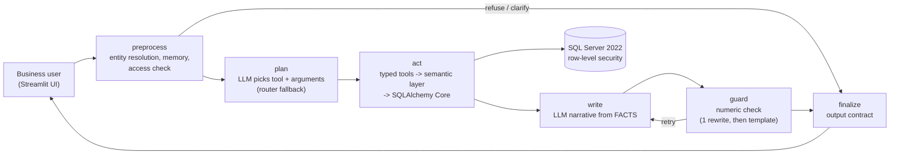
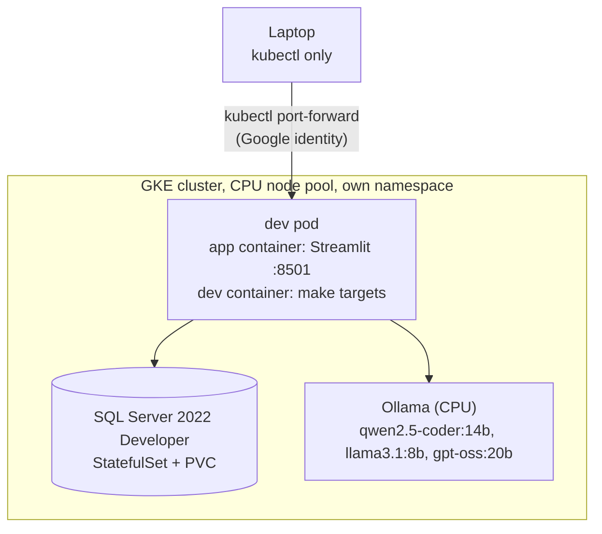

# Architecture

## Request flow

The flow is a LangGraph state graph (`app/agent/graph.py`) with six nodes.

1. **preprocess** (deterministic, no LLM)
   - `app/semantic/entity_resolver.py` finds org units at any level (aliases, ISO codes, BU codes, typo tolerance), metrics and ratios, periods, versions and comparisons, intents (why / trend / rank / breakdown / versions / cockpit), top-N and ranking level.
   - Follow-ups ("now for Canada", "same vs FC2", "why is the first one so low?") are merged with the previous turn's memory.
   - The access check (`app/semantic/access.py`) refuses, narrows or allows the request before any data is read.
   - Ambiguous names (a city with several businesses) trigger a clarification.
2. **plan.** The LLM chooses one of eight typed tools through native or text tool calling (LiteLLM).
   - If the model returns no usable call, a deterministic router supplies one.
   - Every answer records whether the LLM or the router made the choice.
3. **act.** Tools validate their arguments (Pydantic) and call the semantic layer.
   - If the LLM's call fails, the router's call is tried once.
4. **write.** The LLM receives pre-formatted FACTS only and writes 2–4 sentences.
   - It does no arithmetic.
   - The FACTS spell out comparisons ("USD 3.5M (6.8%) above PY (USD 51.0M), favourable").
5. **guard.** Every number in the text must exist in the tool output, within display rounding.
   - If a number does not, the writer gets one rewrite.
   - If the rewrite also fails, a templated answer replaces it.
6. **finalize.** Builds the validated output contract (`FinalAnswer`):
   - narrative + deterministic key-figure bullets + scope notes
   - finance table spec
   - chart spec (chosen by rules, never by the LLM)
   - filters / versions / period / currency
   - SQL
   - exactly three follow-up questions
   - diagnostics

## Tools

| Tool | Answers | Chart |
|---|---|---|
| `get_pnl` | AD50 P&L for an org and period vs PY / Budget / forecasts | MAOP bridge (waterfall) |
| `get_trend` | monthly series of a metric or ratio (Actual, PY, Budget, R12M) | line |
| `get_ratio` | one ratio / KPI vs comparisons | bar |
| `variance_drivers` | account and org drill-down of a variance (pp bridge for margins) | waterfall or stacked bar |
| `rank_entities` | top / bottom BUs, businesses, sectors, countries, regions | horizontal bar |
| `compare_versions` | Actual vs Budget vs FC1/FC2/FC3 (full-year view for forecasts) | grouped bar |
| `get_kpi_cockpit` | operational profitability cockpit, MTD and YTD vs LY and Budget | combo (bars + lines) |
| `run_readonly_sql` | fallback: one SELECT on whitelisted views (sqlglot guard, row limit, timeout) | bar |

## Semantic layer

`app/semantic/` has five parts:

- **Registry.** Built from `metrics.yaml` (AD50 lines, groups 7A/7B, computed amounts, statistics, 21 ratios, cockpit KPIs, driver tree) plus the chart of accounts.
- **Query builder.** `query_builder.py` aggregates leaf accounts with SQLAlchemy Core and pivots them into a "wide" frame where every line, subtotal, group and statistic is a column. The same code runs on SQL Server and DuckDB.
- **Time intelligence.** `time_intel.py` covers YTD, QTD, MTD, R12M, FY, quarters and ranges, the close calendar and the last closed month, PY as shifted Actual, forecast availability by as-of date, like-for-like truncation, and favourability.
- **Access.** `access.py` holds persona scopes and narrowing messages, which mirror the SQL Server security policy.
- **Formatting.** `app/viz/` renders finance tables (thousand separators, negatives in parentheses, favourability colours, bold subtotals), Plotly charts and CSV / Excel export.

## Deployment used for this prototype

- Nothing runs on the laptop except `kubectl`. All services are ClusterIP only.
- The UI is reached with an authenticated port-forward (`make k8s-forward`). There is no public tunnel, because the corporate policy blocks reverse proxies such as cloudflared.
- `docker-compose.yml` runs the same stack (SQL Server + app + optional Ollama) on a single host. The `Dockerfile` was built in-cluster with kaniko; see `results/build/`.

## Swapping components

| Component | Prototype | Change by |
|---|---|---|
| Database | SQL Server 2022 Developer (container) | `DB_HOST` / `DB_NAME` / logins in `.env` (any SQL Server 2016+ with RLS) |
| Light demo backend | DuckDB file | `DB_BACKEND=duckdb` |
| LLM | Ollama qwen2.5-coder:14b on CPU | `LLM_MODEL` (any LiteLLM string: Azure OpenAI, Vertex AI, Bedrock, OpenAI, Ollama) |
| UI | Streamlit | the agent is a plain function `ask(question, user_id, memory)` returning `FinalAnswer` (JSON) |
